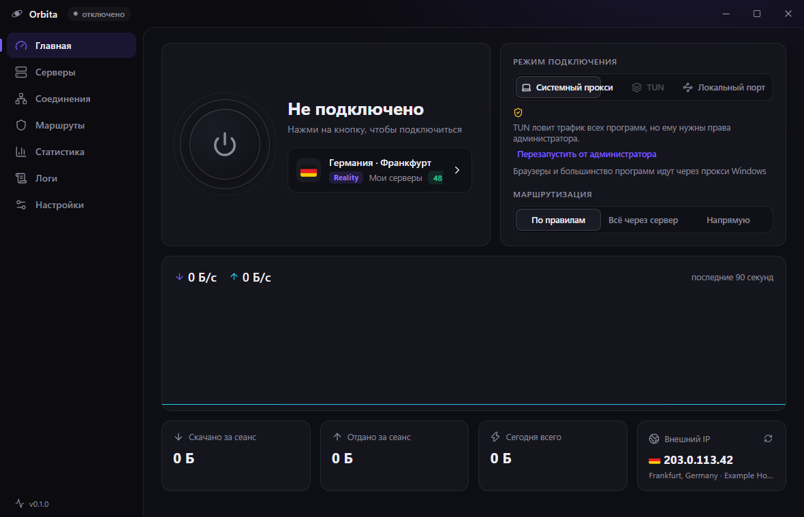

<div align="center">


# Orbita

**A Windows desktop proxy & VPN client powered by sing-box and Xray**

Subscriptions, share links, SOCKS/HTTP proxies, TUN mode for all traffic, live stats and logs — in one clean window.

[](https://github.com/dimon0804/orbita/releases/latest)


[Русский](README.md)

</div>



## Features

- **Protocols:** VLESS (incl. Reality, Vision and xhttp), VMess, Trojan, Shadowsocks (incl. 2022), Hysteria 2 and Hysteria, TUIC, AnyTLS, WireGuard, SOCKS4/4a/5, HTTP and HTTPS.
- **xhttp via a second core.** Servers using the xhttp transport run through Xray, everything else through sing-box. They behave like any other server: TUN, routing rules, auto-select and latency tests just work.
- **Subscriptions:** base64, plain link lists, Clash YAML, sing-box JSON, Xray JSON. Quota and expiry from headers, auto-update. Orbita asks the panel for several formats and keeps the most complete answer, so xhttp servers are not lost.
- **WireGuard:** `wireguard://` links and `.conf` files.
- **Three connection modes:** system proxy, TUN (virtual adapter for every app, games and UDP), local port only (`127.0.0.1:2088`, SOCKS5 + HTTP).
- **Routing:** rule-based, global or direct. Russian sites and IPs go direct, ad blocking, custom rules by domain, IP, process, geosite and geoip.
- **Admin rights once.** Windows asks on first launch; after that Orbita starts elevated via Task Scheduler with no UAC prompt, so TUN is always available.
- **Dashboard:** big connect button, live speed chart, session and daily traffic, exit IP with country flag.
- **Servers:** groups, search, sorting, bulk latency test (works while disconnected), seamless in-group switching, share links, JSON editing.
- **Connections** table, core **logs** with level filter and search, daily and per-server **statistics**.
- **One-click import from NekoBox/NekoRay.**
- **Auto best server** per group, **QR codes** for mobile clients, a **global hotkey** (`Ctrl+Alt+O`), Windows notifications, auto-reconnect.
- **Speed test** for any server in 10 seconds, even while disconnected.
- **Kill switch** (off by default): if the core crashes, traffic does not leak. In system-proxy mode the proxy stays in place; in TUN mode Windows Firewall blocks outbound traffic until Orbita reconnects.
- **Built-in updater** that checks GitHub releases and updates in one click.
- Tray menu, autostart, dark and light themes, accent colors.

## Install

Grab `Orbita-Setup-x.y.z.exe` or `Orbita-Portable-x.y.z.exe` from [Releases](https://github.com/dimon0804/orbita/releases/latest). The build is not code-signed yet, so SmartScreen may warn: “More info” → “Run anyway”.

## Build

```bash
npm install
npm run fetch-core   # download sing-box and Xray into resources/core
npm run dev
npm test             # parsers plus generated configs checked by the real cores
npm run dist         # installer and portable exe in release/
```

Releases are built by GitHub Actions: push a `vX.Y.Z` tag and the installer and portable exe are attached to the release.

## Limitations

- Only VLESS and Trojan over xhttp go through Xray; other Xray transports (kcp etc.) are not supported.
- The TUN kill switch relies on Windows Firewall. If it is disabled or replaced by a third-party antivirus, the block will not work; Orbita warns about it.
- Windows only.

## License

MIT © dimon0804. Bundled third-party parts: the unmodified official [sing-box](https://github.com/SagerNet/sing-box/tree/v1.14.4) v1.14.4 binary (GPL-3.0, license shipped alongside), the unmodified official [Xray-core](https://github.com/XTLS/Xray-core) v26.10.31 binary (MPL-2.0, `LICENSE-xray`), [sing-geosite](https://github.com/SagerNet/sing-geosite)/[sing-geoip](https://github.com/SagerNet/sing-geoip) rule sets, and the [Twemoji](https://github.com/jdecked/twemoji) flag font (CC-BY 4.0) via [country-flag-emoji-polyfill](https://github.com/talkjs/country-flag-emoji-polyfill).
