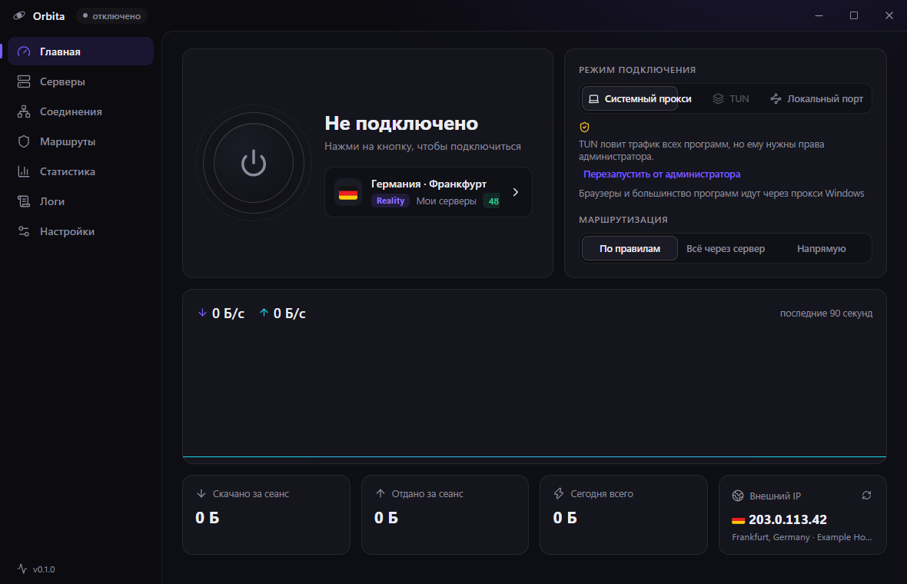
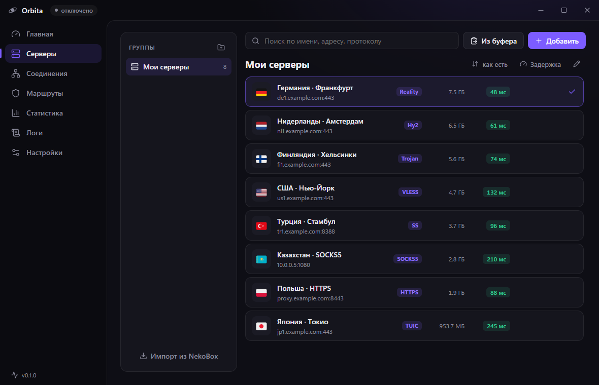

<div align="center">


# Orbita

**Десктопный клиент для прокси и VPN под Windows на ядрах sing-box и Xray**

Подписки, ссылки, SOCKS/HTTP-прокси, режим TUN для всего трафика, живая статистика и логи — в одном аккуратном окне.

[](https://github.com/dimon0804/orbita/releases/latest)


[English](README.en.md)

</div>



## Что умеет

- **Протоколы:** VLESS (в том числе Reality, Vision и xhttp), VMess, Trojan, Shadowsocks (вкл. 2022), Hysteria 2 и Hysteria, TUIC, AnyTLS, WireGuard, SOCKS4/4a/5, HTTP и HTTPS.
- **xhttp через второе ядро.** Серверы с транспортом xhttp ведёт Xray, всё остальное — sing-box. Для тебя это обычные серверы в списке: TUN, правила, «Авто», замер задержки работают одинаково.
- **Подписки:** base64, построчные ссылки, Clash YAML, sing-box JSON, Xray JSON. Квота и срок действия из заголовков, автообновление. Orbita спрашивает панель в нескольких форматах и берёт самый полный ответ — так не теряются xhttp-серверы.
- **WireGuard:** ссылки `wireguard://` и файлы `.conf`.
- **Три режима подключения:**
  - *Системный прокси* — браузеры и большинство программ;
  - *TUN* — виртуальный адаптер, ловит трафик всех программ, игр и UDP;
  - *Локальный порт* — ядро слушает `127.0.0.1:2088` (SOCKS5 и HTTP на одном порту), система не трогается.
- **Маршрутизация:** по правилам, всё через сервер или напрямую. Российские сайты и IP напрямую, блокировка рекламы, свои правила по домену, IP, программе, geosite и geoip.
- **Права администратора один раз.** Windows спрашивает разрешение при первом запуске, дальше Orbita стартует с правами через планировщик задач без окна UAC — TUN доступен сразу.
- **Панель:** большая кнопка подключения, график скорости, трафик за сеанс и за день, внешний IP с флагом страны.
- **Серверы:** группы, поиск, сортировка, замер задержки всех серверов разом (даже без подключения), переключение сервера внутри группы без разрыва, «поделиться» ссылкой, правка в JSON.
- **Соединения:** живая таблица — куда, какая программа, через какой сервер, скорость, закрытие по одному или всех.
- **Логи** ядра с фильтром по уровню и поиском. **Статистика** по дням и по серверам.
- **Импорт из NekoBox/NekoRay** в один клик: группы, подписки, серверы.
- **Авто — лучший сервер:** Orbita сама меряет задержку серверов группы и держит самый быстрый.
- **QR-код сервера** — отсканировать на телефоне в v2rayNG, Hiddify, Streisand.
- **Тест скорости** любого сервера за 10 секунд, даже без подключения.
- **Kill switch:** если ядро упало, трафик не уходит мимо VPN. В системном режиме прокси остаётся на месте, в TUN интернет закрывается брандмауэром Windows до переподключения. По умолчанию выключен.
- **Горячая клавиша** подключения из любой программы (по умолчанию `Ctrl+Alt+O`), уведомления Windows, автопереподключение, если ядро упало.
- **Обновления:** Orbita сама проверяет релизы на GitHub и обновляется в один клик.
- Трей с переключением режимов, автозапуск, тёмная и светлая темы, выбор акцентного цвета.



## Установка

Скачай со страницы [релизов](https://github.com/dimon0804/orbita/releases/latest) `Orbita-Setup-x.y.z.exe` (установщик) или `Orbita-Portable-x.y.z.exe` (без установки) и запусти.

Программа пока не подписана сертификатом, поэтому SmartScreen может предупредить о неизвестном издателе: «Подробнее» → «Выполнить в любом случае». При первом запуске Windows спросит права администратора — это нужно для TUN и спрашивается один раз. Отказаться можно, тогда будут доступны системный прокси и локальный порт.

## Сборка из исходников

```bash
npm install
npm run dev        # разработка
npm run fetch-core # скачать sing-box и Xray в resources/core
npm test           # парсеры ссылок и подписок, проверка собранных конфигов самими ядрами
npm run dist       # установщик и портативная версия в release/
```

Ядра `sing-box.exe` и `xray.exe` лежат в `resources/core` (в git их нет), наборы правил — в `resources/rules`.

Релиз собирается сам: тег `vX.Y.Z` → GitHub Actions собирает установщик и портативную версию и кладёт их в релиз.

## Устройство

| Часть | Где |
|---|---|
| Окно, трей, IPC, подписки | `src/main/index.ts` |
| Запуск ядра, Clash API, замер задержки | `src/main/core.ts` |
| Сборка конфига sing-box | `src/main/configBuilder.ts` |
| Второе ядро Xray для xhttp | `src/main/xray.ts`, `src/shared/xray.ts` |
| Kill switch (брандмауэр Windows) | `src/main/killswitch.ts` |
| Права администратора и автозапуск | `src/main/admin.ts` |
| Системный прокси Windows | `src/main/sysproxy.ts` |
| Разбор ссылок и подписок | `src/shared/links.ts` |
| Импорт из NekoBox | `src/main/nekobox.ts` |
| Интерфейс (React) | `src/renderer/src` |

## Ограничения

- Через Xray идут только VLESS и Trojan с xhttp. Другие транспорты Xray (kcp и т.п.) не поддерживаются.
- Kill switch в TUN работает через брандмауэр Windows. Если брандмауэр выключен или его заменил сторонний антивирус, блокировка не сработает, Orbita об этом предупредит.
- Только Windows.

## Лицензия и сторонние компоненты

Код Orbita — MIT © dimon0804.

- Ядро [sing-box](https://github.com/SagerNet/sing-box) — GPL-3.0. В сборку входит неизменённый бинарник официального релиза v1.14.4, его лицензия лежит рядом (`resources/core/LICENSE`), исходный код — в [репозитории sing-box](https://github.com/SagerNet/sing-box/tree/v1.14.4).
- Ядро [Xray-core](https://github.com/XTLS/Xray-core) — MPL-2.0. В сборку входит неизменённый бинарник официального релиза v26.10.31, лицензия — `resources/core/LICENSE-xray`.
- Наборы правил [sing-geosite](https://github.com/SagerNet/sing-geosite) и [sing-geoip](https://github.com/SagerNet/sing-geoip).
- Шрифт флагов — [Twemoji](https://github.com/jdecked/twemoji) (графика CC-BY 4.0) в сборке [country-flag-emoji-polyfill](https://github.com/talkjs/country-flag-emoji-polyfill).
